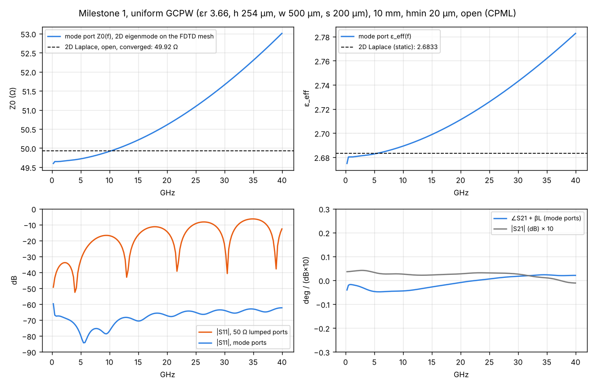

# Validation note — uniform GCPW, milestone 1 (build steps 1–3)

Date: 2026-10-17 · Solver: dev (pre-`20261017.0`) · C f64 reference path



## Structure

Grounded CPW, lossless: εr 3.66, h 254 µm, strip w 500 µm, gaps s 200 µm, via fences idealised as PEC walls 300 µm beyond each gap edge, zero-thickness copper. Bottom ground is the domain's PEC boundary; the top grounds and the air above run into an 8-cell CPML. Line length between reference planes: 10 mm.

Mesh: thirds rule at copper edges (note 0002), min cell 20 µm, graded ×1.3 to 100 µm, Δx 50 µm along the line. 236 × 77 × 33 cells for the lumped-port case.

## References

| Reference | Z0 (Ω) | ε_eff | Notes |
|---|---|---|---|
| 2D Laplace FV, open (10 mm air, 6 mm beyond fences), Richardson to 0 | 49.92 | 2.6833 | quasi-static; Neumann vs PEC outer walls agree to 0.05% |
| Conformal mapping, no fences | 50.25 | 2.6906 | approximate; can't include fences |
| 2D eigenmode on the FDTD mesh, open (PML), 2 GHz | 49.66 | 2.6810 | discrete line the 3D solver supports |

## Results

| Comparison | Range | Result | Plan tolerance | Status |
|---|---|---|---|---|
| Z0 (2D eigenmode on FDTD mesh) vs Laplace, open | 2 GHz | −0.5% | ±1% | pass |
| ε_eff (2D eigenmode on FDTD mesh) vs Laplace | 2 GHz | −0.09% | ±1% | pass |
| 3D FDTD probe extraction vs 2D eigenmode, same mesh, closed box | 2–40 GHz | Z0 ≤ 0.55% | — | consistency |
| Mode ports, uniform line: \|S11\| | 1–40 GHz | ≤ −62 dB | — | |
| Mode ports, uniform line: \|S21\| | 1–40 GHz | within 0.004 dB of 0 dB | — | |
| Mode ports, uniform line: ∠S21 vs −βL | 1–40 GHz | ≤ 0.05° | — | |
| Native vs WebAssembly (kernel) | — | 1e-14 rel | — | pass |
| Browser (headless Chromium) vs native, lumped ports | 0.5–40 GHz | \|ΔS\| 1e-10 | — | pass |
| Browser vs native, mode ports | 0.5–40 GHz | \|ΔS\| 7e-7 | — | pass (conditioning, note 0003) |

The rise of Z0 and ε_eff with frequency (Z0 49.7 → 53.0 Ω, ε_eff 2.68 → 2.78 from 2 to 40 GHz) is real full-wave dispersion: the substrate channel between the fences has its first cutoff near 52 GHz. A quasi-static reference can't show it; the HFSS and openEMS comparisons will.

## Losses (step 4)

| Comparison | Result |
|---|---|
| Djordjevic–Sarkar RO4350B (Dk 3.66, Df 0.0037 @ 10 GHz), 8 Debye poles: FDTD \|S21\| vs 2D mode exp(−αL) | within 0.0044 dB, 1–40 GHz |
| Debye fit vs DS model, 0.1–40 GHz | ε′ 0.03%, tan δ 0.66% |
| Copper cavity Q, smooth / Groisse R_q 1 µm | +0.36% / +0.98% |
| GCPW conductor loss, FDTD SIBC vs resolved-skin-depth 2D reference (σ 1e6) | −21% at 10 µm cells (issue 9, note 0006) |

## GPU (step 7)

| Comparison | Result | Plan tolerance |
|---|---|---|
| f32 WebGPU vs f64 C, GCPW S21, lossless | 5e-6 dB, 4e-5° | ±0.01 dB, ±0.1° |
| Same, Debye substrate + copper SIBC | 4e-6 dB, 3e-5° | |

## KiCad import (steps 5–6)

| Fixture | Result |
|---|---|
| Microstrip 0.55 mm on 10-mil RO4350B, 8 mm | \|S11\| ≤ −49 dB, Z0 49.90 Ω vs Hammerstad–Jensen 50.38 Ω (−1.0%) |
| GCPW with via fences | \|S11\| ≤ −26 dB (via fence vs wall-fenced feeds), Z0 49.7 Ω |

## Copper thickness

| Comparison | Result |
|---|---|
| Laplace (open, fence as wall), 35 µm copper bars vs zero thickness | 46.761 Ω vs 49.92 Ω, ε_eff 2.5436 vs 2.6833 |
| Imported GCPW, 35 µm copper, port Z0 at 2 GHz vs Laplace | +0.48% (20 µm cells), +0.25% (10 µm) |
| Laplace with a 20 µm, εr 3.5 mask slab: sheets / 35 µm copper | 48.626 / 45.625 Ω |
| Imported GCPW + mask slab: sheets / 35 µm copper (20 µm cells) | −0.48% / +0.78% |
| Imported microstrip, 35 µm copper, 3D run | \|S11\| ≤ −48.5 dB, Z0 48.6 Ω |

## Gerber import and checkpoints (steps 6, 8)

| Test | Result |
|---|---|
| GCPW fixture as KiCad-style Gerbers vs the KiCad import | same copper raster (48k points), mesh, vias, nets; first 300 steps bit-identical |
| Microstrip fixture as Gerbers, stackup entered in the editor (browser) | Z0 49.88 Ω, \|S11\| ≤ −49 dB — same as the KiCad import |
| Checkpoint/resume, CPU (C and browser, page reload mid-run) | S-parameters bit-identical to a straight run |
| GPU → checkpoint → CPU resume, lossy GCPW | S21 within 2e-6 dB, 1e-5° |

## Not yet covered

- openEMS / HFSS / measurement comparisons (step 9).
- Conductor-loss accuracy on edge-dominated lines (issue 9).

## Reproduce

```sh
make -C solver
./solver/build/gcpw_line --modeports --hmin 20 --dx 50 --df 0.25 --out runs/mp
./solver/build/gcpw_line --hmin 20 --dx 50 --df 0.25 --decay 1e-7 --out runs/lumped
python3 tools/eval_modeports.py runs/mp
python3 tools/analyze_gcpw.py runs/lumped
python3 tools/plot_m1_validation.py runs/mp runs/lumped validation/figures/gcpw-m1.png
```
